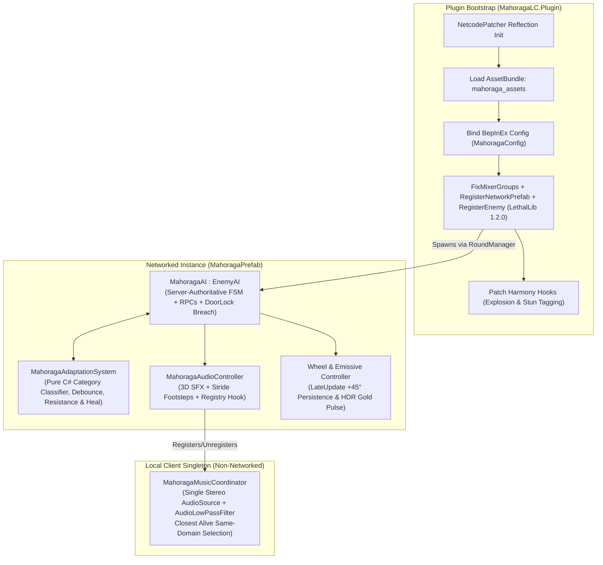
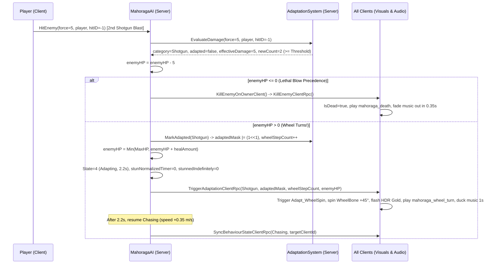

# Mahoraga LC — Technical Architecture (`ARCHITECTURE.md`)

> **Status:** **FINALIZED v2** — All engine versions, `Assembly-CSharp.dll` signatures, networking authority rules, `hitID` classifications, `DoorLock` calls, layer masks, and `LethalLib 1.2.0` overloads are **LOCKED** and verified against [`docs/RE_FINDINGS.md`](file:///home/fede/Escritorio/Mahoraga%20LC/docs/RE_FINDINGS.md).

---

## 1. System Overview & Target Runtime Stack

**Fede.MahoragaLC** is a server-authoritative **BepInEx 5** + **LethalLib 1.2.0** + **Unity Netcode for GameObjects (`1.12.2`, NetcodePatcher)** enemy mod targeting Lethal Company on **Unity `2022.3.62f2`** with **HDRP `14.0.12`** and **AI.Navigation `1.1.6`**.



---

## 2. Repository & Build Pipeline Layout

| Directory | Role | Build Output |
|---|---|---|
| `assets/model/` | Blender source (`Mahoraga.blend`), Unity FBX (`Mahoraga.fbx`, `3.75 u`), 2K HDRP textures, QA renders, `icon_256.png` | Input to `UnityProject` & Thunderstore icon |
| `assets/audio/` | 8 verified `.ogg` clips (raw download isolated inside `assets/audio/source/`) | Input to `UnityProject` |
| `UnityProject/` | Unity `2022.3.62f2` + HDRP `14.0.12` + NGO `1.12.2` + AI.Navigation `1.1.6` | Windows x64 AssetBundle `mahoraga_assets` |
| `Plugin/` | C# `.NET Standard 2.1` project (`Fede.MahoragaLC.csproj`) + `NetcodePatcher` post-build | `Fede.MahoragaLC.dll` (IL-patched for NGO RPCs) |
| `dist/` | Thunderstore artifact (`manifest.json`, `README.md`, `CHANGELOG.md`, `icon.png`, `BepInEx/plugins/Fede-MahoragaLC/Fede.MahoragaLC.dll`, `BepInEx/plugins/Fede-MahoragaLC/mahoraga_assets`) | Release `.zip` + deployed to `MahoragaDev` profile |

---

## 3. Plugin Bootstrap & LethalLib 1.2.0 Registration (`MahoragaLC.Plugin`)

### 3.1 Exact Startup Sequence (`Plugin.Awake()`)
1. **NetcodePatcher Weaving Initialization (MANDATORY FIRST):**
   Execute the standard NetcodePatcher reflection loop over `Assembly.GetExecutingAssembly().GetTypes()` calling every method with `[RuntimeInitializeOnLoadMethodAttribute]` (wrapped safely to handle `ReflectionTypeLoadException`). Must run before registering any `NetworkPrefab`!
2. **Configuration Binding (`MahoragaConfig.Bind(Config)`):**
   Binds `[Spawning]`, `[Combat]`, `[Movement]`, and `[Audio]`. If `!MahoragaConfig.EnableMod.Value`, logs disabled status and returns cleanly.
3. **AssetBundle Loading:**
   Loads `Path.Combine(Path.GetDirectoryName(Assembly.GetExecutingAssembly().Location), "mahoraga_assets")` via `AssetBundle.LoadFromFile(...)`. Loads and caches:
   - `MahoragaEnemyType` (`EnemyType`)
   - `MahoragaPrefab` (`GameObject`)
   - `MahoragaTerminalNode` (`TerminalNode`)
   - `MahoragaTerminalKeyword` (`TerminalKeyword`)
   - Cached fallback `AudioClip` dictionary for all 8 clips (`mahoraga_music_main`, `mahoraga_wheel_turn`, etc.).
4. **Runtime Config & Audio Mixer Repair:**
   - Applies `MahoragaConfig.PowerLevel.Value` and `MahoragaConfig.MaxCount.Value` onto `MahoragaEnemyType`.
   - Calls **`LethalLib.Modules.Utilities.FixMixerGroups(MahoragaPrefab);`** so `VoiceSFXSource` and `BodySFXSource` route cleanly through Lethal Company's live `Diagetic` AudioMixer!
5. **Network Prefab Registration (Verified LethalLib 1.2.0):**
   ```csharp
   LethalLib.Modules.NetworkPrefabs.RegisterNetworkPrefab(MahoragaPrefab);
   ```
6. **All-Moons Enemy Registration (Verified LethalLib 1.2.0 Overload 3):**
   Verified from decompiled `LethalLib.Modules.Enemies.AddEnemyToLevel`: LethalLib resolves per-moon priority in strict order `(1) specific vanilla Levels.LevelTypes -> (2) customLevelRarities[moonName] -> (3) custom tags -> (4) Vanilla -> (5) Modded -> (6) All`.
   ```csharp
   var levelRarities = new Dictionary<Levels.LevelTypes, int>
   {
       { Levels.LevelTypes.All, MahoragaConfig.DefaultInteriorRarity.Value },
       { Levels.LevelTypes.Modded, MahoragaConfig.DefaultInteriorRarity.Value }
   };
   var customLevelRarities = new Dictionary<string, int>();
   MahoragaConfig.ApplyMoonOverrides(levelRarities, customLevelRarities);

   LethalLib.Modules.Enemies.RegisterEnemy(
       MahoragaEnemyType,
       LethalLib.Modules.Enemies.SpawnType.Default,
       levelRarities,
       customLevelRarities,
       MahoragaTerminalNode,
       MahoragaTerminalKeyword);
   ```
   - **Optional Outdoor Spawn (`AllowOutdoorSpawn == true`):**
     Instantiates a runtime clone `outdoorEnemyType = Object.Instantiate(MahoragaEnemyType)` with `outdoorEnemyType.isOutsideEnemy = true`, keeping the same `MahoragaPrefab`, and calls `Enemies.RegisterEnemy(outdoorEnemyType, Enemies.SpawnType.Outside, outsideRarities, outsideCustomRarities, infoNode: null, infoKeyword: null)` (passing `null` terminal assets avoids duplicate Bestiary entries!).
   - LethalLib automatically hooks `Terminal.Start`, assigns the next free `creatureFileID` to `MahoragaTerminalNode`, copies it onto `MahoragaPrefab`'s `ScanNodeProperties.creatureScanID`, registers the `"mahoraga"` `info` keyword, and inserts Mahoraga into `QuickMenuManager.testAllEnemiesLevel` (so Imperium discovers it automatically!).
7. **Minimal Harmony Patching:**
   Applies lightweight postfix hooks in `MahoragaLC.Patches.ExplosionTrackingPatch` solely on `Landmine.SpawnExplosion` and `StunGrenadeItem.ExplodeStunGrenade` to record `(Vector3 pos, float time, float range)` for 100% deterministic classification.

---

## 4. Server-Authoritative AI & Netcode Design (`MahoragaLC.AI.MahoragaAI`)

### 4.1 Strict Ownership & Authority Invariant (Verified `RE_FINDINGS.md §5.1 & §5.4`)
- **Permanent Host/Server Ownership:** Spawned enemies default to `OwnerClientId == 0` (`IsServer && IsOwner`). **NEVER** call `ChangeOwnershipOfEnemy(...)`! This guarantees pure server-authoritative execution with zero ownership ping-pong desyncs.
- **Server (`IsServer`) owns:**
  - All 5 FSM state transitions (`currentBehaviourStateIndex` `0..4`), target tracking (`targetPlayer`), `DetectNoise` routing, `NavMeshAgent` destination/speed, and `DoorLock` forcing.
  - Attack selection (`Cleave` vs `Slam`), hit timing, and cone/AoE hit validation.
  - `MahoragaAdaptationSystem` counters, resistance math, `enemyHP` mutation, healing, stun negation, and `KillEnemyOnOwnerClient()`.
- **CRITICAL Owning-Client `DamagePlayer` Rule (`RE_FINDINGS.md §5.4`):**
  - `PlayerControllerB.DamagePlayer(...)` and `KillPlayer(...)` guard **`if (!IsOwner || isPlayerDead || !AllowPlayerDeath()) return;`**!
  - Calling `targetPlayer.DamagePlayer(...)` directly on the Server silently fails on non-host remote players!
  - Therefore, whenever the Server confirms a hit against player `p`, Server invokes **`ApplyPlayerDamageClientRpc((int)p.playerClientId, damage, (int)causeOfDeath, knockbackForce)`**, and ONLY the client where `localPlayer.playerClientId == targetPlayerClientId` calls `localPlayer.DamagePlayer(damage, true, true, (CauseOfDeath)causeOfDeath, 0, false, knockbackForce)`.
  - Both `CleaveDamage = 55` (`CauseOfDeath.Mauling`) and `SlamDamage = 65` (`CauseOfDeath.Crushing`) are **`>= 50`**, cleanly bypassing Lethal Company's `< 50` critical-injury 5-HP floor!
- **All Clients (including Host) own:**
  - Animator parameters (`Speed`, `IsChasing`, `IsStunned`, `IsDead`, triggers), `LateUpdate` cumulative `WheelBone` `+45°` persistence, HDR golden emissive pulse, 3D SFX, stride footsteps, and local `MahoragaMusicCoordinator`.

### 4.2 Exact Verified `EnemyAI` Overrides (`Assembly-CSharp.dll`)

| Verified Override Signature | Context | Implementation Contract |
|---|---|---|
| `public override void Start()` | All | Calls `base.Start()`. Ensures `enemyBehaviourStates` has 5 entries. Detects actual spawn domain (`bool outside = transform.position.y > -40f; if (isOutside != outside) SetEnemyOutside(outside);`) so outdoor-spawned or Imperium-spawned instances sync `isOutside` accurately. Caches `WheelBone` + rest rotation, `SwordBone`, `mainRenderer`, `audioController`. Sets `enemyHP = MahoragaConfig.MaxHP.Value`. If `!IsServer`, calls `RequestFullSyncServerRpc()`. |
| `public override void DoAIInterval()` | Owner/Server (`if (!IsServer) return;`) | Calls `base.DoAIInterval()` (sets `agent.SetDestination(destination)` & calls `SyncPositionToClients()`). Evaluates `Patrolling (0)`, `Investigating (1)`, `Chasing (2)` logic, `CheckLineOfSightForClosestPlayer(...)`, target retargeting, locked `DoorLock` scan, and attack range entry (`<= 2.6m`). |
| `public override void Update()` | All | Calls `base.Update()` (handles `stunNormalizedTimer` decay, client SmoothDamp interpolation, and `DoAIInterval` scheduler). **All clients:** updates `Speed` float, `IsStunned` bool (`(stunNormalizedTimer > 0f \|\| stunnedIndefinitely > 0) && !isEnemyDead && currentBehaviourStateIndex != 4`), emissive flash decay, and stride footsteps. **Server:** ticks attack windup/hit/recovery timers, `2.20s` adaptation timer, locked-door breach timer, LOS memory timer, and enforces ZapGun immunity clearing (`if (adaptation.IsAdapted(ZapGun)) { stunNormalizedTimer = 0f; stunnedIndefinitely = 0; }`). |
| `private void LateUpdate()` | All | Applies deterministic cumulative `WheelBone` local Y rotation (`wheelDisplayAngle`) relative to cached bind rest rotation so the wheel stays permanently turned at `45° × wheelStepCount` after `Adapt_WheelSpin` ends. |
| `public override void DetectNoise(Vector3 noisePosition, float noiseLoudness, int timesPlayedInOneSpot = 0, int noiseID = 0)` | Server (`if (!IsServer) return;`) | When in `Patrolling (0)` or `Investigating (1)` and `!isEnemyDead`, checks same inside/outside domain (`noisePosition.y > -40f == isOutside`) and effective distance `<= 24f * Mathf.Clamp(noiseLoudness, 0.5f, 1.5f)`. Sets `investigateTargetPos`, resets `investigateTimer = 8.0f`, transitions to `Investigating (1)`. |
| `public override void HitEnemy(int force = 1, PlayerControllerB playerWhoHit = null, bool playHitSFX = false, int hitID = -1)` | Runs on EVERY client via LC RPC — **guard mutations with `if (!IsServer) return;`** | **AUDIO TRAP GUARD (`EnemyAI.cs:2445-2454`):** Always call `base.HitEnemy(force, playerWhoHit, playHitSFX: false, hitID)`! Passing `playHitSFX: true` when `enemyType.hitBodySFX != null && creatureVoice != null` triggers an unguarded `creatureVoice.PlayOneShot(enemyType.hitEnemyVoiceSFX)` null-clip warning if `hitEnemyVoiceSFX == null`. Instead, route normal hit impact / adapted deflect audio explicitly through `audioController` (single owner), and manage `enemyHP` exclusively on `IsServer`! On **Server**: classifies source (`Melee`, `Shotgun`, `Explosion`, `Other`), applies adapted resistance / adapting armor, subtracts integer damage from `enemyHP`. **Lethal Blow Rule:** if `enemyHP <= 0`, calls `KillEnemyOnOwnerClient()`. Else if already adapted -> `PlayDeflectFeedbackClientRpc`. Else increments counter; if `>= Threshold` -> triggers Adaptation (`State 4`, heal, wheel +45°, `TriggerAdaptationClientRpc`). If patrolling/investigating and alive -> aggroes onto `playerWhoHit`! |
| `public override void HitFromExplosion(float distance)` | Owner/Server | **TRAP GUARD:** `Landmine.SpawnExplosion` calls `HitEnemyOnLocalClient(6)` immediately followed by `HitFromExplosion(distance)`. Do **NOT** double-damage or double-increment adaptation if `HitEnemy(6)` already fired within the last `0.15s`; only record explosion fallback if called standalone! |
| `public override void SetEnemyStunned(bool setToStunned, float setToStunTime = 1f, PlayerControllerB setStunnedByPlayer = null)` | Server + Clients | Classifies stun (`ZapGun` if `setStunnedByPlayer?.currentlyHeldObjectServer is PatcherTool`, else `StunGrenade`). If `isEnemyDead` OR `currentBehaviourStateIndex == 4 (Adapting)` OR `adaptation.IsAdapted(cat)`: **negate stun completely** (`stunNormalizedTimer = 0f; stunnedIndefinitely = 0;`) and on Server send `PlayDeflectFeedbackClientRpc((byte)cat)` (throttled `0.8s`). Otherwise calls `base.SetEnemyStunned(...)` and on Server records stun exposure (with ZapGun continuous-beam debounce); if threshold reached -> clears `stunNormalizedTimer = 0f; stunnedIndefinitely = 0;` and triggers `Adapting (4)`! |
| `public override void OnCollideWithPlayer(Collider other)` | Local collided client | Calls `PlayerControllerB player = MeetsStandardPlayerCollisionConditions(other);` (non-null ONLY on collided player's owning client!). If valid, not dead/stunned/adapting, sends `RequestContactAttackServerRpc((int)player.playerClientId)` so Server triggers an immediate telegraphed attack check if Chasing and off cooldown. |
| `public override void KillEnemy(bool destroy = false)` | All clients (via LC base RPC) | Calls `base.KillEnemy(destroy)`. **AUDIO SINGLE-OWNER RULE (`EnemyAI.cs:2041-2045`):** `EnemyAI.dieSFX` MUST be left `null` on `MahoragaPrefab` (since `base.KillEnemy` calls `creatureVoice.PlayOneShot(dieSFX)`), leaving `audioController.OnMahoragaDied()` as the **sole authoritative owner** of playing `deathClip` (`mahoraga_death`, guarded so it plays once even if `dieSFX != null` was accidentally set) + executing the instant `0.35s` music fade-out! Also sets `creatureAnimator.SetBool("IsDead", true)`, `IsStunned = false`, `IsChasing = false`, disables `CollisionCollider`, stops `NavMeshAgent`, and extinguishes `WheelGlowLight`. |

### 4.3 Custom Netcode RPC Protocol (NGO `1.12.2` + NetcodePatcher)

All RPCs pass exclusively NGO-blittable primitives (`int`, `byte`, `float`, `bool`, `Vector3`):

| RPC Name | Direction | Payload | Purpose |
|---|---|---|---|
| `SyncBehaviourStateClientRpc` | Server -> All | `int newState`, `int targetPlayerClientId` | Synchronizes `currentBehaviourStateIndex`, `targetPlayer`, `IsChasing`, and triggers `mahoraga_roar` on fresh aggro (12s cooldown). |
| `TriggerAttackClientRpc` | Server -> All | `bool isSlam`, `bool isDoorBash` | Fires `AttackSlam` or `AttackCleave` trigger + windup `mahoraga_slash` / roar SFX. |
| `ApplyPlayerDamageClientRpc` | Server -> All | `int targetPlayerClientId`, `int damage`, `int causeOfDeath`, `Vector3 knockbackForce` | **Owning-client damage execution:** matching local player executes `DamagePlayer(damage, true, true, (CauseOfDeath)causeOfDeath, 0, false, knockbackForce)`. |
| `PlayAttackImpactClientRpc` | Server -> All | `bool isSlam`, `Vector3 impactPos` | Plays 3D `mahoraga_impact` SFX + distance-scaled HUD camera shake (`<= 14m`). |
| `TriggerAdaptationClientRpc` | Server -> All | `byte categoryId`, `int newAdaptedMask`, `int wheelStepCount`, `int newHP` | Syncs client `adaptedMask`, `wheelStepCount`, `enemyHP`; clears `stunNormalizedTimer = 0f; stunnedIndefinitely = 0;`; fires `Adapt` trigger; spins `WheelBone` `+45°`, flashes golden HDR emissive + `WheelGlowLight`, plays `mahoraga_wheel_turn` (with 1.0s music ducking). |
| `PlayDeflectFeedbackClientRpc` | Server -> All | `byte categoryId` | Brief golden rim glint + metallic chime tick signaling to players that this weapon/stun category is adapted! |
| `RequestContactAttackServerRpc` | Client -> Server (`RequireOwnership = false`) | `int collidingPlayerClientId` | Notifies Server of player collision from `OnCollideWithPlayer` to evaluate immediate attack entry. |
| `RequestFullSyncServerRpc` | Client -> Server (`RequireOwnership = false`) | `ServerRpcParams rpcParams` | Late-join / newly-spawned client requests authoritative state snapshot. |
| `ApplyFullSyncClientRpc` | Server -> Requesting Client | `int state`, `int adaptedMask`, `int wheelStepCount`, `int currentHP`, `bool dead`, `ClientRpcParams` | Snaps `WheelBone` to `wheelStepCount * 45°` and syncs state/HP/death on late-joining client. |

### 4.4 Wheel of Adaptation Sequence Diagram



---

## 5. `MahoragaAdaptationSystem` Pure C# Design

Isolated in `Plugin/AI/MahoragaAdaptationSystem.cs` (zero Unity `NetworkBehaviour` dependency; 100% unit-testable):

```csharp
namespace MahoragaLC.AI
{
    public enum AdaptationCategory : byte
    {
        Melee = 0,
        Shotgun = 1,
        ZapGun = 2,
        StunGrenade = 3,
        Explosion = 4,
        Other = 5
    }
}
```

### Verified Source Classification & Edge-Case Matrix (`RE_FINDINGS.md §5.2`)
1. **Melee (`0`)**: `hitID == 1` (Shovel/Stop Sign/Yield Sign) OR `hitID == 5` (Kitchen Knife) OR `playerWhoHit?.currentlyHeldObjectServer is Shovel or KnifeItem`.
2. **Shotgun (`1`)**: `playerWhoHit != null && (playerWhoHit.currentlyHeldObjectServer is ShotgunItem || (hitID == -1 && force >= 2))` *(CRITICAL: `ShotgunItem.cs` passes default `hitID = -1` with `force = 5 (<3.7m), 3 (<6m), 2 (>=6m)`!)*.
3. **ZapGun (`2`)**: `SetEnemyStunned` where `setStunnedByPlayer?.currentlyHeldObjectServer is PatcherTool`.
   - **Continuous-Beam Debounce**: New engagement (`now - lastZapTime > 1.5f`) increments count by `1`; uninterrupted stream increments count by `1` every `3.0s`.
   - **Immunity Trap Guard**: Once adapted, MUST clear BOTH `stunNormalizedTimer = 0f` AND `stunnedIndefinitely = 0`!
4. **StunGrenade (`3`)**: `SetEnemyStunned` from `StunGrenadeItem`, Radar Booster flash, or any non-`PatcherTool` stun.
5. **Explosion (`4`)**: `playerWhoHit == null && force == 6 && hitID == -1` OR within `0.20s` and `range + 5f` of a recorded `Landmine.SpawnExplosion` (Harmony postfix ring buffer). Deduplicated against `HitFromExplosion(float distance)` using a `0.15s` explosion hit timestamp guard!
6. **Other (`5`)**: Company Cruiser (`hitID == 331`), modded weapons, custom hazards.
7. **Fractional Damage Buffer & Armor**:
   - Already adapted: `scaled = force * (1f - AdaptedDamageResistance)`. If `>= 0.999f`, `intDamage = 0`; else accumulates in `float fractionalBuffer` -> `FloorToInt`.
   - During `Adapting (4)`: `0.25f` damage multiplier (75% bracing armor), zero stun interrupts.

---

## 6. Door-Forcing Subsystem (`DoorLock` Verified API)

Verified directly from `docs/re/decompiled/DoorLock.cs`:
- **Automatic Unlocked Doors (`DoorLock.OnTriggerStay`)**:
  - Because `MahoragaPrefab` root AND `CollisionCollider` carry **`Layer = 19 (Enemies)`** and **`Tag = "Enemy"`**, and `MahoragaEnemyType.doorSpeedMultiplier = 1.5f`, Lethal Company's native `DoorLock.OnTriggerStay` automatically swings unlocked closed doors open in `~0.67s`!
- **Active Locked-Door Breach (`DoorLock.isLocked == true`)**:
  - Locked doors enable `navMeshObstacle.carving = true`, carving a hole in the NavMesh.
  - Server runs a zero-alloc `Physics.OverlapSphereNonAlloc(transform.position + transform.forward * 1.4f + Vector3.up * 1.5f, 1.4f, doorBuffer, 1 << 9)` (`Layer 9 = InteractableObject`) every `DoAIInterval` while moving in States `0, 1, 2`.
  - If a closed `DoorLock` with `doorLock.isLocked == true` lies within `3.2 u` along Mahoraga's approach vector and `MahoragaConfig.CanForceLockedDoors.Value == true`:
    1. Pauses advance at the door (`doorForceProgress += dt`).
    2. Fires `TriggerAttackClientRpc(isSlam: false, isDoorBash: true)` + `PlayAttackImpactClientRpc` at `t = 0.4s` and `t = 1.6s` (players behind the locked door hear brutal pounding!).
    3. At `doorForceProgress >= 2.2s`:
       ```csharp
       doorLock.UnlockDoorSyncWithServer();
       doorLock.GetComponent<AnimatedObjectTrigger>()?.TriggerAnimationNonPlayer(false, overrideBool: true);
       doorLock.OpenDoorAsEnemyServerRpc();
       ```
       NavMesh obstacle uncarves immediately and Mahoraga storms straight through!
- **Powered Steel Blast Doors (`TerminalAccessibleObject`)**: Untouched, preserving Ship Operator tactical counterplay.

---

## 7. Dynamic Audio & Singleton Music Architecture (`MahoragaLC.Audio`)

### 7.1 `MahoragaAudioController` (Per-Instance on `MahoragaPrefab`)
- Registers/unregisters with `MahoragaMusicCoordinator` in `OnEnable()` / `OnDisable()` / `OnDestroy()`.
- Emits 3D SFX on `voiceSource` (`mahoraga_roar`, `mahoraga_wheel_turn`, `mahoraga_death`) and `bodySource` (`mahoraga_footstep_1`, `mahoraga_footstep_2`, `mahoraga_slash`, `mahoraga_impact`), routed through `Diagetic` mixer via `FixMixerGroups`.
- **Stride-Driven Footsteps**: Accumulates horizontal displacement `strideAccum` (alternating `mahoraga_footstep_1` / `mahoraga_footstep_2` with `±0.06` pitch variance every `1.75m` Walk / `2.15m` Run) — 100% deterministic across host & clients with zero AnimationEvent fragility.

### 7.2 `MahoragaMusicCoordinator` (Local Client Singleton — Zero Overlap)
- Lazily creates one persistent local GameObject (`"MahoragaMusicCoordinator"`) with:
  - One stereo `AudioSource` (`spatialBlend = 0.0f`, `loop = true`, `playOnAwake = false`, `priority = 32`, `clip = mahoraga_music_main`).
  - One `AudioLowPassFilter` (`cutoffFrequency = 22000f`, `lowpassResonanceQ = 1.0f`).
- **Per-Frame Mix Loop (`Update()`):**
  1. Resolve `localPlayer = GameNetworkManager.Instance?.localPlayerController`. If null or `StartOfRound.Instance == null || StartOfRound.Instance.inShipPhase`, fade smoothly to `0` and stop.
  2. Resolve **spectate-aware listener**:
     `effectivePlayer = (localPlayer.isPlayerDead && localPlayer.spectatedPlayerScript != null) ? localPlayer.spectatedPlayerScript : localPlayer;`
  3. Zero-alloc `for` loop over `ActiveInstances` to select ONLY the **single closest alive Mahoraga in the same environment (`effectivePlayer.isInsideFactory == !instance.AI.isOutside`)**.
  4. If none found OR `minDist >= outerRange` (`35m`) OR `!MahoragaConfig.MusicEnabled.Value`:
     - Fade `volume` toward `0.0f` (`deathFastFade ? 3.0f/s : 2.2f/s`, hitting `0.0` in `~0.35s` on death!). Stop `AudioSource` once silent.
  5. Otherwise:
     - Ensure `musicSource.isPlaying` (starting cleanly at `volume = 0.0f`).
     - Proximity curve: `t = Mathf.InverseLerp(outerRange, innerRange, minDist); proximity = t * t * (3f - 2f * t);`
     - State multiplier: `0.65f` (`Patrolling`/`Investigating`), `1.00f` (`Chasing`/`Attacking`), `0.55f` during first `1.0s` of `Adapting` gong ducking.
     - Throttled (`0.15s`) LOS wall check using verified exact LC mask:
       ```csharp
       bool occluded = Physics.Linecast(
           effectivePlayer.gameplayCamera.transform.position,
           closest.AI.eye != null ? closest.AI.eye.position : closest.transform.position + Vector3.up * 3.30f,
           StartOfRound.Instance.collidersAndRoomMaskAndDefault,
           QueryTriggerInteraction.Ignore);
       ```
       - Clear LOS: `targetCutoff = Mathf.Lerp(900f, 22000f, proximity)`, `occlusionVolMult = 1.0f`.
       - Wall Occluded: `targetCutoff = isChasing ? 2600f : 1100f`, `occlusionVolMult = 0.70f`.
     - Smoothly damp `musicSource.volume` and `lowPassFilter.cutoffFrequency` every frame.

---

## 8. Wheel Rotation & Emissive Flash Controller

- **`LateUpdate()` Cumulative Wheel Lock**: Caches `wheelRestLocalRot = wheelBone.localRotation` in `Awake()`. Smoothly interpolates `wheelDisplayAngle` toward `wheelStepCount * 45f` (with mechanical ease-out synchronized to `t = 0.25s..1.05s` of `Adapt_WheelSpin`) and applies `wheelBone.localRotation = wheelRestLocalRot * Quaternion.Euler(0f, wheelDisplayAngle, 0f)`. Guarantees permanent `45°, 90°, 135°... 360°` orientation across every clip transition!
- **HDR Emissive Pulse (`HDRP/Lit`)**: Uses cached `MaterialPropertyBlock` (`Shader.PropertyToID("_EmissiveColor")`) on `mainRenderer` (zero material leak!). Idle subtle bronze shimmer scales softly with `wheelStepCount`; `TriggerAdaptationClientRpc` spikes HDR gold `#FFB830` (`60` nits) + `WheelGlowLight` (`450 lm`) at `t = 0.35s` and decays smoothly over `1.8s`.

---

## 9. Verification & QA Matrix

1. **Pure Unit Tests (`Plugin.Tests`):** Verify `MahoragaAdaptationSystem` (all 6 categories, Shotgun `hitID = -1` trap, Explosion deduplication, ZapGun debounce, 95% vs 100% resistance + fractional buffer, lethal-blow precedence, heal clamping) and `MoonRarityOverrides` parser.
2. **NetcodePatcher Audit:** Verify IL weaving succeeds with zero errors for NGO `1.12.2` and all 9 custom RPCs are woven into `Fede.MahoragaLC.dll`.
3. **Unity Bundle Audit:** Verify Unity `2022.3.62f2` + HDRP `14.0.12` + NGO `1.12.2` Windows x64 `mahoraga_assets` bundle contains zero missing scripts, `Layer 19` + `Tag "Enemy"` on root & `CollisionCollider`, `Layer 22` + `isTrigger = false` on `ScanNode`, `Layer 14` on `MapDot`, `NavMeshAgent (r=0.60, h=3.30)`, 5 `enemyBehaviourStates`, and `Diagetic` mixer.
4. **Live / Imperium Verification:** Spawn on Experimentation/Rend/Titan, confirm **`3.75 u` (`1.5×`) stature** next to `2.50 u` player, hallway (`3.916 u`) & door (`3.10–3.22 u`) clearance, locked-door breach, 2-hit adaptation wheel turn + gong + heal + immunity across all 6 categories, owning-client damage sync in multiplayer, 35m–16m music + wall LPF + `isInsideFactory` isolation + instant death fade-out, and `info mahoraga` Bestiary entry.
