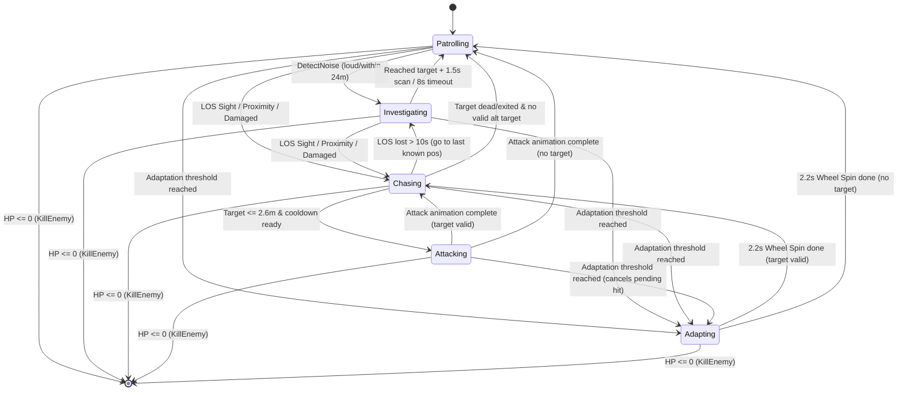

# Mahoraga LC — Game Design Document (`MAHORAGA_GDD.md`)

> **Status:** **FINALIZED v2** — Gameplay systems, exact stature (`3.75 u`), state machine, adaptation math, audio curve, and LethalLib 1.2.0 config specs are **LOCKED** and verified against [`docs/RE_FINDINGS.md`](file:///home/fede/Escritorio/Mahoraga%20LC/docs/RE_FINDINGS.md).

---

## 1. Executive Summary & Core Fantasy

**Eight-Handled Sword Divergent Sila Divine General Mahoraga** (*Makora Sila-Octo*) is an apex, server-authoritative multiplayer horror boss entity for **Lethal Company**.

Unlike single-gimmick vanilla entities (Bracken's stare check, Coil-Head's freeze check, Thumper's straight-line charge), Mahoraga embodies **inevitability and relentless adaptation**:
1. **Dread Before Sight:** Long before you see his towering silhouette, the muffled bass pulse of his signature theme (`mahoraga_music_main`) reverberates through the steel walls of the facility, growing clearer and louder as he closes in.
2. **No Trivial Door Cheese:** Slamming or key-locking a hallway door buys precious seconds, not immunity — Mahoraga forces standard interior doors open with bone-jarring force.
3. **The Wheel Turns:** Fighting back works *at first*. Shovels stagger his HP, shotguns tear chunks away, zap guns lock him down, flashbangs blind him — **until the golden Eight-Handled Dharma Wheel hovering behind his head clicks 45° with a resonant temple gong.** Instantly, he heals, breaks crowd control, flashes radiant gold, and adapts (`95%` damage resistance / `100%` stun immunity) to that entire category of weapon or tool for the rest of the round.
4. **Survival vs. Slaying:** Most crews will flee, coordinate Ship Operator blast doors, and evacuate with their scrap. A fearless, well-equipped crew *can* kill Mahoraga — but only by rotating weapon categories and landing lethal burst damage before his Wheel adapts to their entire loadout.

---

## 2. Visual & Lore Identity

- **Stature:** Towering at exactly **`1.5x` Lethal Company crew height** (`playerHeight = 2.50 u` -> **`mahoragaTargetHeight = 3.75 u`** feet-to-skull-crown, sitting between Coil-Head `3.60 u` and Nutcracker `3.90 u`), with the floating Dharma Wheel top kept `<= 3.90 u` to clear `3.916 u` factory hallway ceilings cleanly while navigating `1.51–1.64 u` doors via a doorway-safe `NavMeshAgent` (`radius = 0.60, height = 3.30, baseOffset = 0.0`).
- **Silhouette & Anatomy:**
  - Pale alabaster/bone-white hyper-muscular humanoid torso, bare muscular calves and feet.
  - Elongated, eyeless white skull with a wide fanged grimace, **4 sweeping white wings** fanning from the eye sockets/temples (`Wing_UL`, `Wing_UR`, `Wing_LL`, `Wing_LR`), and a thick curved **occipital tail/crest** (`HeadTail_1`–`HeadTail_4`) draping down his back.
  - Charcoal-black pleated **hakama trousers** bound by a dark wrapped **obi waist sash**.
  - **Sword of Extermination (`Taima no Tsurugi`)** bandaged directly onto the right forearm (`SwordBone`), blade extending past the fist.
  - **Eight-Handled Dharma Wheel** (`WheelBone`): antique metallic gold 8-spoked halo-wheel hovering cleanly behind the upper back/head, rotating **+45°** per completed adaptation (`8 × 45° = 360°`).
- **Lethal Company Tone Integration:** Presented in Company records and Terminal Bestiary (`TERMINAL_BESTIARY.md`) as an uncontained apex anomaly (**Threat Level: 95%**) manifesting across all moons' industrial facilities.

---

## 3. Five-State Server-Authoritative AI Behavior

All AI decisions, pathing, target selection, door forcing, damage evaluation, and adaptation triggers run **strictly on the Server/Host** (`IsServer`) and broadcast transitions/events to all connected clients for 100% multiplayer consistency.

### 3.1 State Breakdown

| Index | State | Base Speed | Core Behavior & Exit Rules |
|---|---|---|---|
| `0` | **Patrolling** | `3.2 m/s` | Roams interior AI nodes (`StartSearch` / `allAINodes`, or `outsideAINodes` when spawned outside). Scans wide forward cone (`65°`, `26m` range) + `4.0m` 360° bio-presence awareness. Listens via `DetectNoise`. |
| `1` | **Investigating** | `4.5 m/s` | Moves purposefully toward last heard noise or last known player position (`investigateTimer = 8.0s`). Heightened sight (`30m`, `5.0m` proximity). On arrival (`<= 2.2m`), pauses `1.5s` scanning before returning to `Patrolling`. |
| `2` | **Chasing** | `6.2 m/s` (+`0.35 m/s` per adaptation, cap `+1.4 m/s`) | Relentless pursuit of `targetPlayer`. Plays `mahoraga_roar` on initial aggro (12s cooldown). Switches target if another valid player in the same domain (`isInsideFactory`) is `< 65%` of current target distance and in clear LOS. Retains pursuit memory for `10.0s` after losing LOS before transitioning to `Investigating` at last known position. |
| `3` | **Attacking** | `1.2 m/s` windup -> `0.0 m/s` recovery | Commits to a telegraphed **Sword Cleave** or **Divergent Slam** (see Section 3.2). Rotates smoothly toward target during windup; evaluates server-authoritative hit cone/AoE at impact frame; enters `1.35s` post-attack cooldown before striking again. |
| `4` | **Adapting** | `0.0 m/s` | Triggered immediately when any unadapted category hits `AdaptationThreshold` (and the blow was non-lethal). Cancels active stuns, holds dramatic bracing stance for **`2.20s`** (`Adapt_WheelSpin`), rotates `WheelBone` **+45°**, sounds `mahoraga_wheel_turn` bronze gong (`45m` radius), flashes HDR golden wheel emissive + point light, heals `20%` Max HP, grants `75%` damage armor & stun immunity during the spin, then locks permanent round resistance for that category and snaps right back into `Chasing`. |

*(Overlay States: **Stunned** via `stunNormalizedTimer > 0` pauses movement/attacks and plays `Stun` clip unless stun source is adapted or currently in `Adapting`; **Dead** via `KillEnemy()` sets `isEnemyDead = true`, `IsDead = true`, disables agent/colliders, plays `mahoraga_death`, and triggers instant music fade-out.)*

### 3.2 Combat Attacks & Telegraphing

| Attack | Trigger Condition | Windup (Telegraph) | Total Duration | Reach / Geometry | Damage | Feedback |
|---|---|---|---|---|---|---|
| **Sword Cleave** (`Attack_Cleave`) | Primary strike at `<= 2.6m` | `0.38s` | `1.15s` | `3.0m` reach, `110°` forward arc | `55 HP` (configurable) | `mahoraga_slash` at `t=0.20s`, `mahoraga_impact` on hit, medium screen shake |
| **Divergent Slam** (`Attack_Slam`) | 2+ players within `3.8m`, OR 30% chance / every 3rd strike when close (`<= 2.6m`), OR elevated weight after >=1 adaptation | `0.55s` | `1.45s` | `3.5m` full `360°` AoE shockwave | `65 HP` (configurable) + outward knockback | Heavy roar/whoosh on windup, earth-shaking `mahoraga_impact` + strong HUD camera shake at `t=0.55s` |

- **Fairness Guarantee:** Players walking/sprinting backward upon seeing the `0.38s–0.55s` windup CAN dodge out of range — rewarding spatial awareness and stamina management over unavoidable instant contact kills.
- **Anti-Clip Contact Fallback:** `OnCollideWithPlayer` initiates an immediate attack check when in `Chasing` and off cooldown (rather than dealing zero-telegraph instant death on brush contact), preventing players from sprinting straight through Mahoraga's torso.

### 3.3 Door-Forcing & Anti-Cheese Mechanics

| Door / Obstacle Type | Behavior | Rationale |
|---|---|---|
| **Unlocked Interior Doors** (`DoorLock`, `isLocked == false`) | Opens rapidly (`0.6s` while Chasing, `1.2s` while Patrolling) with heavy slam SFX. | Prevents trivial "close door to break pathing" cheese. |
| **Key-Locked Interior Doors** (`DoorLock`, `isLocked == true`) | When `CanForceLockedDoors = true` (default): Mahoraga halts at the door, plays `Attack_Cleave` + loud `mahoraga_impact` bash heard through walls, and **forces the lock open after `2.2s`**, swinging the door wide open (`UnlockDoorSyncWithServer` + open). | Locked doors buy a tense 2-second escape window rather than permanently trapping Mahoraga. |
| **Powered Steel Blast Doors** (`TerminalAccessibleObject`) | **Respected** (blocks Mahoraga; he cannot hack powered bulkheads). AI detects blocked path and re-routes or prowls nearby. | Preserves iconic Lethal Company **Ship Operator teamwork** (trapping Mahoraga in a sealed wing via Terminal codes). |
| **Unreachable Railings / Tables** | If target stands on an unreachable off-NavMesh prop (`PathPartial`), Mahoraga moves to the closest NavMesh edge and uses **Divergent Slam** (`3.5m` 3D sphere/cylinder check with generous vertical tolerance `±1.8m`) to punish low-ledge/railing exploits. | Eliminates classic railing-cheese without breaking real elevation gaps. |

---

## 4. The Wheel of Adaptation Mechanic

### 4.1 Source Taxonomy (`AdaptationCategory`)

Every incoming damage event (`HitEnemy`) and stun event (`SetEnemyStunned`) is classified server-side into one of **6 deterministic categories**:

| Enum ID | Category | Lethal Company Sources Mapped | Classification Rule (Verified `Assembly-CSharp.dll`) |
|---|---|---|---|
| `0` | **`Melee`** | Shovel, Yield Sign, Stop Sign, Kitchen Knife | `hitID == 1` (Shovel/Signs) or `hitID == 5` (Knife), or `playerWhoHit` holding `Shovel`/`KnifeItem` |
| `1` | **`Shotgun`** | Double-Barrel Shotgun | `playerWhoHit != null && (playerWhoHit.currentlyHeldObjectServer is ShotgunItem \|\| (hitID == -1 && force >= 2))` *(LC `ShotgunItem` passes `hitID = -1`, `force = 2/3/5`)* |
| `2` | **`ZapGun`** | Zap Gun (`PatcherTool`) | `SetEnemyStunned` from player holding `PatcherTool` (also clears `stunnedIndefinitely = 0` once adapted!) |
| `3` | **`StunGrenade`** | Homemade Flashbang, Stun Grenade, Radar Booster Flash | `SetEnemyStunned` from `StunGrenadeItem` / non-`PatcherTool` flash |
| `4` | **`Explosion`** | Landmine, Easter Egg blast, Jetpack explosion, Cruiser blast | `playerWhoHit == null && force == 6 && hitID == -1` (deduplicated with `HitFromExplosion(float)`) or recent `Landmine.SpawnExplosion` within blast radius |
| `5` | **`Other`** | Company Cruiser ramming (`hitID == 331`), modded weapons, custom hazards | Catch-all fallback so **no modded weapon can bypass adaptation** |

### 4.2 Adaptation Rules, Debounce & Kill Math

1. **Counter & Threshold:** Each category tracks an integer exposure count `counts[cat]` starting at `0`. Default threshold is **`AdaptationThreshold = 2`** (configurable `1–5`).
2. **ZapGun Continuous-Beam Debounce (Anti-Spam):** Because `PatcherTool` calls `SetEnemyStunned` repeatedly every tick while beaming, a continuous zap stream counts as **1 exposure** on initial lock-on and increments again only after **`3.0s`** of sustained zapping OR upon a **fresh zap engagement** after a `>= 1.5s` gap.
3. **Lethal-Blow Precedence Rule (Lore-Accurate Counterplay):**
   - Incoming damage is applied **first** (reduced by resistance if already adapted).
   - If `enemyHP <= 0` after applying that hit, **Mahoraga dies immediately** — he cannot adapt to an attack that destroys him in time!
   - If `enemyHP > 0` AND `!IsAdapted(cat)` AND `counts[cat] >= AdaptationThreshold`: **Wheel of Adaptation triggers immediately**, transitioning to State `4 (Adapting)`.
4. **Effect of Completed Adaptation:**
   - **Wheel Turns `+45°`** (`WheelBone` cumulative angle advances by 1 spoke).
   - **Partial Heal:** Server restores `Mathf.RoundToInt(MaxHP * AdaptationHealPercent)` (default `20%` of `18 HP` = **`+4 HP`**, clamped to `MaxHP`).
   - **Damage Resistance:** Future damage from `cat` is multiplied by `(1.0 - AdaptedDamageResistance)` (default `0.95` = **95% reduction**, configurable `0.90–1.00`). Fractional damage is accumulated in a per-instance `float fractionalDamageBuffer` so `95%` resistance still allows slow chip damage (e.g., 4 point-blank shotgun blasts = `4 × 5 × 0.05 = 1 HP`), whereas `1.00` grants pure `0` damage immunity.
   - **Stun Immunity:** Once adapted to `ZapGun` or `StunGrenade`, all future stuns from that category are **100% negated** (zero stagger, zero `SetEnemyStunned` duration; triggers subtle metallic deflect/gong tick feedback!).
   - **Escalation:** Each completed adaptation grants `+0.35 m/s` chase speed (capped at `+1.4 m/s`), visibly raising dread as the fight drags on.
5. **Kill Feasibility Verification (`DefaultMaxHP = 18`):**
   - *Solo Shovel player:* 2 hits (`2 dmg`) -> Melee adapted (`+4 heal` -> `18/18 HP`). Cannot solo with shovel alone -> must run!
   - *Armed 4-player crew:* 2 point-blank Shotguns (`10 dmg` -> `8/18 HP`) -> Shotgun adapted (`+4 heal` -> `12/18 HP`) -> crew switches to 2 Explosives / Easter Eggs / Landmines (`6 + 6 = 12 dmg` -> **`0/18 HP, DEAD`** before the 2nd explosive can adapt!). Or 1 Shotgun (`5`) + 1 Landmine (`6`) + 1 Shotgun (`5`, triggers adapt -> `6/18 HP`) + 1 Landmine (`6` -> **`0/18 HP, DEAD`**!).
   - **Verdict:** Terrifying survival-horror threat for normal crews, thrilling tactical boss kill for coordinated high-arsenal crews.

---

## 5. Dynamic Proximity & Encounter Audio Design

### 5.1 Soundtrack (`mahoraga_music_main`)
- Source: User-specified track trimmed **strictly from `0:51` onward**, loudness-normalized (`-14 LUFS`, `<= -1.0 dBTP`), click-free seamless loop.
- **Single-Instance Global Mix Rule:** A dedicated local-client singleton music coordinator evaluates all active alive `MahoragaAI` instances and selects ONLY the **single closest Mahoraga in the same environment** — guaranteeing **zero duplicate track overlap** even if multiple instances are spawned via config/Imperium.

### 5.2 Distance Curve, State Scaling & Wall Muffling

| Distance (`d`) | Base Volume Curve | Base Low-Pass Cutoff (Clear LOS) | Wall-Occluded Low-Pass Cutoff |
|---|---|---|---|
| `> 35.0m` | `0.00` (silent; pauses after `3.0s`) | `900 Hz` | `900 Hz` |
| `35.0m -> 16.0m` | Smooth S-curve `SmoothStep(35m -> 16m)` (`0.0 -> 1.0`) | Smooth lerp `900 Hz -> 22,000 Hz` | Clamped to `1100 Hz` (Patrol/Investigate) or `2600 Hz` (Chase) + `0.70x` vol |
| `<= 16.0m` | `1.00 * stateMultiplier * MasterVolume` | `22,000 Hz` (full unfiltered stereo intensity) | `2600 Hz` + `0.70x` vol (snaps open smoothly the instant he rounds the corner!) |

- **State Multipliers:**
  - `Patrolling` / `Investigating`: `0.65x` (creeping ambient dread before eye contact).
  - `Chasing` / `Attacking`: `1.00x` (full encounter terror).
  - `Adapting`: Brief `0.55x` ducking during the first `1.0s` so the resonant bronze gong (`mahoraga_wheel_turn`) pierces the mix cleanly, then surges back to `1.00x`.
- **Inside / Outside Isolation (`isInsideFactory`):**
  - Strictly checks `effectiveListener.isInsideFactory == !mahoraga.isOutside` (where `effectiveListener` transparently follows `spectatedPlayerScript` if the local player is dead!).
  - Entering/exiting the Facility smoothly crossfades the track out (`0.40s`) so interior boss music NEVER leaks onto the outdoor moon or ship deck.
- **Death Fade-Out:** On `KillEnemy()`, immediately ramps music volume to `0.0` over `0.35s` and stops playback cleanly (unless another alive Mahoraga is within range).

### 5.3 Spatial 3D SFX Palette
- `mahoraga_wheel_turn` (`45m` 3D): Unmistakable metallic ratchet + temple gong broadcast across nearby corridors whenever the Wheel turns.
- `mahoraga_footstep_1` / `mahoraga_footstep_2` (`30m` 3D): Alternating heavy bare-foot thuds synchronized to locomotion stride distance (slower heavy cadence while stalking, rapid earth-shaking thuds while charging).
- `mahoraga_slash` & `mahoraga_impact` (`30m` 3D): Sword cleave whoosh, devastating impact crunch, and locked-door bashing strikes.
- `mahoraga_roar` (`45m` 3D): Deep inhuman shikigami roar on aggro lock-on.
- `mahoraga_death` (`45m` 3D): Dissipating collapse rumble when slain.

---

## 6. Spawning, Moon Distribution & Configuration

- **Target Moons:** Registered across **ALL vanilla moons (`Levels.LevelTypes.All = -1`) AND modded moons (`Levels.LevelTypes.Modded = 1024`)** via `LethalLib 1.2.0` Overload 3 (`Enemies.RegisterEnemy(enemy, SpawnType.Default, levelRarities, customLevelRarities, infoNode, infoKeyword)`), supporting both vanilla and LLL/LethalExpansion custom moon overrides.
- **Default Ecology:** Interior apex enemy (`isOutsideEnemy = false`, `PowerLevel = 3`, `MaxCount = 1`, `DefaultInteriorRarity = 20`).
- **Optional Outdoor Mode:** Disabled by default (`AllowOutdoorSpawn = false`). When enabled in config, registers an additional outdoor spawn profile (`OutdoorRarity = 12`) using outdoor AI nodes while keeping full `isInsideFactory` music isolation intact!

### BepInEx Configuration (`BepInEx/config/Fede.MahoragaLC.cfg`)

| Section | Key | Type | Default | Range / Notes |
|---|---|---|---|---|
| `Spawning` | `EnableMod` | `bool` | `true` | Master toggle for enemy registration |
| `Spawning` | `DefaultInteriorRarity` | `int` | `20` | `0–100` weight across all vanilla & modded moons |
| `Spawning` | `MoonRarityOverrides` | `string` | `""` | Comma-separated overrides, e.g. `Experimentation:10,Titan:35,Artifice:40` |
| `Spawning` | `AllowOutdoorSpawn` | `bool` | `false` | Also allow Mahoraga to spawn outdoors |
| `Spawning` | `OutdoorRarity` | `int` | `12` | `0–100` outdoor spawn weight when enabled |
| `Spawning` | `PowerLevel` | `float` | `3.0` | `1.0–10.0` moon power budget cost |
| `Spawning` | `MaxCount` | `int` | `1` | `1–5` max concurrent spawns per moon |
| `Combat` | `MaxHP` | `int` | `18` | `6–100` base HP in Lethal Company hit-force units |
| `Combat` | `AdaptationThreshold` | `int` | `2` | `1–5` hits/stuns of a category before Wheel turns |
| `Combat` | `AdaptedDamageResistance` | `float` | `0.95` | `0.50–1.00` damage reduction once adapted (`0.95` = 95%, `1.00` = immune) |
| `Combat` | `AdaptationHealPercent` | `float` | `0.20` | `0.00–0.50` fraction of `MaxHP` healed per Wheel turn |
| `Combat` | `CleaveDamage` | `int` | `55` | `10–100` HP damage for Sword Cleave |
| `Combat` | `SlamDamage` | `int` | `65` | `10–100` HP damage for Divergent Slam |
| `Combat` | `CanForceLockedDoors` | `bool` | `true` | Allows forcing key-locked `DoorLock` doors after `2.2s` |
| `Movement` | `PatrolSpeed` | `float` | `3.2` | `1.0–10.0` m/s |
| `Movement` | `InvestigateSpeed` | `float` | `4.5` | `1.0–12.0` m/s |
| `Movement` | `ChaseSpeed` | `float` | `6.2` | `2.0–14.0` m/s |
| `Movement` | `ChaseSpeedPerAdaptation` | `float` | `0.35` | `0.0–1.5` m/s escalation bonus per adapted category (cap `4x`) |
| `Audio` | `MusicEnabled` | `bool` | `true` | Toggle dynamic proximity boss theme |
| `Audio` | `MusicMasterVolume` | `float` | `0.75` | `0.0–1.0` peak volume multiplier |
| `Audio` | `MusicOuterRange` | `float` | `35.0` | `10.0–80.0` m where music begins fading in |
| `Audio` | `MusicInnerRange` | `float` | `16.0` | `5.0–40.0` m where music reaches full intensity |
| `Audio` | `EnableWallMuffling` | `bool` | `true` | Toggle `AudioLowPassFilter` LOS wall occlusion muffling |

---

## 7. Multiplayer & Ship Operator Synergy

- **Ship Radar (`MapDot`):** Appears as a moving red entity blip on the Ship Monitor (`MapRadar` layer), allowing the Ship Operator to call out corridor approaches and seal powered **Steel Blast Doors** to buy teammates an escape route.
- **Scanner (`ScanNode`):** Red Danger scan node (`Mahoraga` / `Divine General`) unlocks the Bestiary entry upon first scan (`info mahoraga` on Terminal).
- **Zero Desync Guarantee:** Host calculates every state change, hit, door breach, and Wheel turn; all clients observe identical animation triggers, Wheel angle (`45° * N`), golden emissive flash, gong chime, and death collapse simultaneously.
